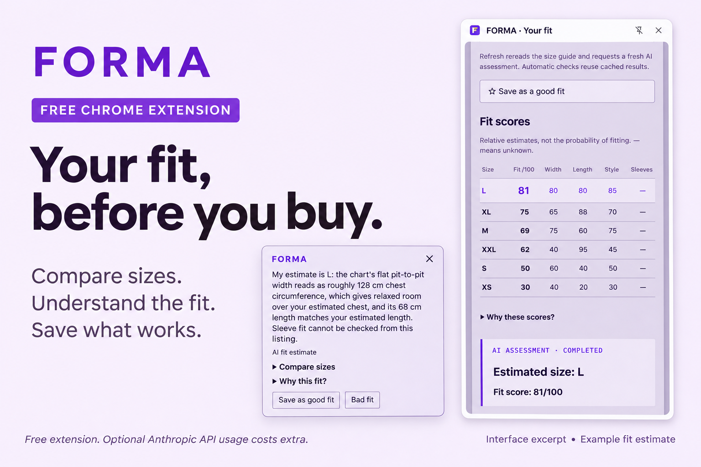

# FORMA · Your fit

A Chrome extension that tells you which size of a garment fits you, and why. It works on regular clothing shops and on marketplace listings such as Ricardo, Tutti, Vinted or eBay. English interface; profile notes can be English or German. Version 2.0.2.

[Download the latest release](https://github.com/moritzlauper/forma/releases/latest) · [Installation](#install)

*Promotional artwork adapted from the FORMA interface. Example estimates are illustrative. Interface details may differ by version.*

## Install

Run `npm ci`, `npm run check`, `npm test` and `npm run build`. Open `chrome://extensions`, enable Developer mode, choose **Load unpacked** and select `dist`. After rebuilding, press reload on the FORMA card and refresh open shop tabs. Profiles, saved clothes and the API key from earlier versions are kept.

In the panel, enter your Anthropic API key and choose **Enable FORMA on shop pages**. Chrome asks once for access to websites and to api.anthropic.com. From then on, clothing product pages are checked automatically. **Analyse this page** forces an assessment on a page FORMA did not recognise.

## How FORMA decides

FORMA works in three stages. The design rationale is in [docs/konzept-umbau.md](docs/konzept-umbau.md) (German).

**1. Read the page, locally.** The content script collects the title, brand, breadcrumbs, attributes (for example «Grösse: XL», «Material: Baumwolle»), the offered sizes with availability, the description, lines that mention measurements or model details, size tables (HTML tables and div-built grids, also in closed tabs and size-guide dialogs) and up to four photos. Cards that link to other products are ignored. Marketplace listings are recognised by domain or by signals such as a condition attribute and a single size. No AI is involved, and pages that are not a single clothing product are skipped.

The page is read once it has settled, then watched for 12 seconds to catch late size guides, then left alone. Countdowns and clocks are stripped before comparing, so a ticking auction never triggers a new assessment.

**2. Read the garment.** One AI request per product, streamed, with a structured answer. For every offered size it returns flat garment measurements in cm with their source (`size chart`, `seller`, `photo`, `estimate`) and a tolerance, body-size ranges if the chart gives body measurements, and a judgement of width, length and sleeves for you. Where nothing is published, the AI estimates typical measurements for the garment type, brand, cut and size, marked as estimates. Values FORMA parses itself from charts and seller text («Brust 58 cm», «pit to pit 24"») override the AI's numbers.

**3. Decide, locally.** Each size gets three checks (width, length, sleeves), each a step from much too small (−2) to much too large (+2), using the strongest basis available:

1. your feedback on this exact product
2. comparison in cm with clothes you wore of the same group (T-shirts, sweats, shirts, outerwear, trousers, shorts, dresses, shoes)
3. your own body measurements and preferred fit
4. body ranges from the size chart
5. the AI judgement

The checks combine into a score out of 10. One clearly bad dimension caps the score. The best available size is recommended; below 5, FORMA recommends no size and says why. Sizes you reported too small (and smaller ones) are excluded. Changing your profile, notes or feedback recomputes open pages instantly without a new request.

## Your profile

Height, weight, usual sizes, build, preferred fit and free-text fit notes. Optional body measurements (chest, waist, hips, arm, inseam, foot) are the most precise basis. The strongest evidence is **clothes that fit you**: open the product page of something you own and use **Fits me** with the size you wear. Its measurements are stored, and future garments of the same group are compared with it in centimetres. **Doesn't fit** records the size you tried and what was wrong.

Automatic body estimates from FORMA 1.x are no longer used; only values you entered count as measurements.

## Requests, cost and privacy

The default model is Claude Haiku 5.5 (`claude-haiku-5-5`); Sonnet 5.5 and Opus 5.5 can be chosen in Settings. Ollama on this computer and a **No AI** mode (published measurements only) are also available.

Opening a product you already checked reuses the saved answer (40 are kept). **Refresh** asks again. The default limit is 100 requests, counted including failures, and adjustable in Settings. Failed requests are never retried automatically. The on/off switch in the header stops reading and cancels running requests.

Sent to the provider: the product page's title, attributes, sizes, description, measurement lines, tables and up to three photo URLs, plus your profile without your name, your notes and the clothes you saved (without their URLs). The API key is stored in the extension's local storage on this device and is not part of profile exports. Browser storage is not an encrypted vault.

## Development

- `src/page/` reads pages (`listing.ts`), opens size guides (`guide.ts`) and draws the on-page card (`card.ts`)
- `src/assess/` parses charts (`charts.ts`), talks to the AI (`reader.ts`), builds the person and references (`person.ts`) and decides (`decide.ts`)
- `src/background.ts` orchestrates, caches and budgets; `src/panel.tsx` and `src/ui/` are the side panel

`npm test` runs unit tests, including HTML fixtures modelled on a live Ricardo listing and the SCRT size chart. `npm run test:browser` loads the built extension into an isolated Chromium with a simulated AI and checks automatic assessment, cache reuse, one request despite a ticking countdown, local recomputation after feedback and the off switch. Run `npx playwright install chromium` once before. Live AI judgements are not covered by the tests.
